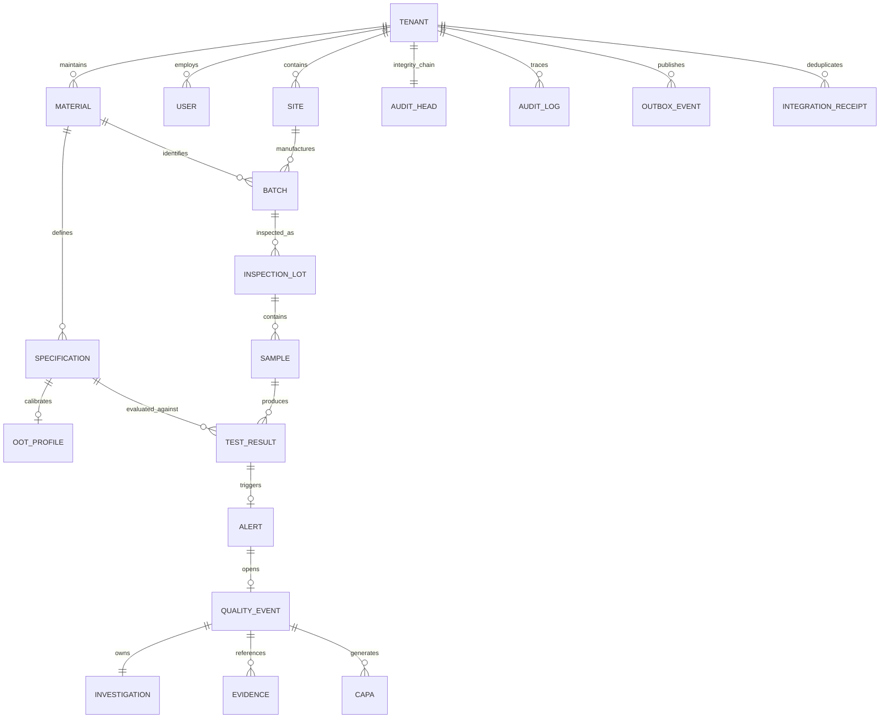

# Transactional data model (implemented starter)

The actual ORM source is `app/models.py`. This compact version is sufficient for demonstration but lacks mature product/method registries, enterprise organizational hierarchies, legal entities, source-version chains, electronic signature objects and full equipment provenance. Do not force unrelated external IDs into the same string namespace.
