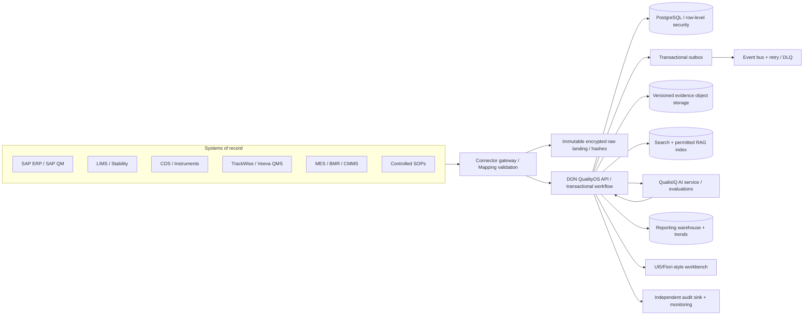

# DON QualityOS — Enterprise Product Blueprint

**Product:** DON QualityOS (platform) + QualisIQ (AI investigation). **Version:** 0.2 demo build, October 2026. **Data:** entirely synthetic and non-GMP. **Design inspiration:** SAP S/4HANA QM, Sanofi's published Veeva quality transformation, Cipla's published TrackWise/QC digitalization. NOT affiliated with those companies and does not ingest their internal data.

## 1. Thesis

Create a unified, multi-site quality operating system that places the *quality object graph* at the center: Site → Material → Manufacturing batch → Inspection lot → Sample → Versioned specification → Laboratory result → Exception alert → Quality event → Phase I/II or OOT investigation → Evidence → CAPA → Independent QA approval → Report → Product-quality monitoring. No AI-initiated batch release, result invalidation, or automatic retesting. Production use requires validated systems and procedures.

## 2. What we learned, without overstating the sources

- **SAP:** A planned inspection lot and its result recording are distinct from event-controlled quality notifications. SAP exposes inspection lot operations through a documented API. That maps to master data, lots, results, alerts and notifications in our domain.
- **Sanofi:** Its Veeva case study emphasizes consolidated quality processes, shared core models, integration across ERP/quality/documents/training, global/site process governance, central analytics, and an MVP-led roll-out. Published deployment numbers are benchmarks for architecture thinking only, not our deployment statistics.
- **Cipla:** Its FY2022–23 report describes TrackWise QMS processes (deviations, CAPA, laboratory nonconformance and incidents, complaints, audits) and modernization of QC/stability management. This motivates DON's QMS/LIMS service boundaries.
- **FDA/MHRA/ICH:** OOS must be investigated, investigation records preserved and quality decisions justified. Data integrity and risk management are foundational. Enterprise styling does not imply compliance.

## 3. Domain services (modular monolith now; separable later)

| Bounded context | Entities | Current API / status | Enterprise extension |
|---|---|---|---|
| Tenant/identity | Tenant, Site, User | JWT demo auth, role/site/tenant checks | SAML/OIDC SSO, MFA, ABAC, SCIM, SOD |
| Material and manufacturing | Material, Batch | Master read; preseeded | SAP material/batch master adapters |
| Inspection planning | InspectionLot, Sample | Master read; results refer to lot/sample | Inspection characteristic catalogs; sampling plans |
| Lab execution | TestResult, Specification, OOTProfile | Working immutable source IDs and versioned limits | CDS raw data, instrument inventory, calibration, LIMS sync |
| Exception detection | Alert | Working deterministic OOS and demo statistical OOT | SOP-controlled OOT profiles, method-based models, drift |
| Quality events | QualityEvent, Investigation | Working role-based state machine | Full deviation, complaint, change-control case types |
| CAPA | CAPA | Working simplified tasks and QA effectiveness checkpoint | Risk assessment, action templates, escalation, recurrence |
| Evidence and documents | Evidence, ControlledDocument | Hash/references, synthetic document metadata | Versioned object store, SOP workflows, WORM backups |
| Audit and governance | AuditLog, AuditHead | Hash-linked audit chain, verification API | Independent append-only ledger, signed timestamps, SIEM |
| Connectivity | IntegrationReceipt, OutboxEvent | Idempotent ingestion, atomic bulk, undelivered outbox | Reliable worker, retries, DLQ, adapter SDK |
| Intelligence | QualisIQ evidence brief | Deterministic, source-linked checklist | Permission-scoped retrieval, document chunk citations, LLM evaluation |
| Insights | Outcome/status overview | SQL aggregate endpoint | Time-series warehouse, APQR, release-cycle KPIs, trend dashboards |

## 4. Desired production topology

**The zip implements the API and transactional models.** External connectors, event delivery workers, RAG embeddings, warehouse, KMS, OIDC, WORM backup, independent electronic-signature engine and full user interface are roadmap components only.

## 5. Data and authority rules

1. SAP ERP/QM is authoritative for manufacturer material, site, batch, and inspection-lot identifiers when integrated; never generate a duplicate and call it an SAP identifier.
2. LIMS is authoritative for sample/result versions and timestamps, while CDS/instrument systems remain authoritative for electronic raw data.
3. QMS is authoritative for approved workflow outcomes, CAPA, and controlled deviations. DON may serve as the QMS itself when validated and designated the system of record, otherwise it mirrors and links records.
4. Each inbound envelope carries source_system, source_record_id, event_at, ingested_at, schema_version, hash, external reference and idempotency key. Source data is immutable; corrections are new linked revisions, never silent overwrites.
5. Specifications and OOT baselines are versioned and date-effective. Overlapping approved versions or ambiguous units block ingestion. OOT thresholds must be predefined in approved quality procedures.
6. Human QA authority and batch release remain independent from analytics. AI writes suggestions only, never approvals or specification changes.
7. Every tenant is isolated; site policies enforce least privilege. Cross-site product quality oversight requires explicit authorized global role.
8. Time-series data can be aggregated and compared by site/material/method. Do not pool incompatible methods, units, timepoints or specifications without approved justification.

## 6. Event states and permissions

- **OOS:** DETECTED → TRIAGED → PHASE_I_OPEN → PHASE_I_REVIEW → QA_EVALUATION (or PHASE_II_OPEN → PHASE_II_REVIEW → QA_EVALUATION) → REPORT_DRAFT → QA_REVIEW_PENDING → APPROVED → CLOSED.
- **OOT:** DETECTED → TRIAGED → OOT_REVIEW → QA_EVALUATION (or OOT_ESCALATED → QA_EVALUATION) → common QA path.
- **CAPA:** OPEN → IN_PROGRESS → EFFECTIVENESS_PENDING → VERIFIED (by a different QA reviewer), or authorized QA cancellation.
- **Approval gates:** case documentation, evidence reference, independent review, version check, reason for transition, event history.
- **Never conflate:** `QA investigation approved` ≠ `batch usage decision` ≠ `batch released` ≠ `regulatory approval`.

## 7. Insight products

- Enterprise quality control tower: open exceptions by region, site, product, method, shift and age.
- LIMS laboratory worklist: test result statuses, outliers, review queue, chain-of-custody.
- Investigation cockpit: Phase I/II checklists, instrument/method correlations, historical similar cases, linked source documents.
- Recurrence graph: site/instrument/method/batch shared factors; similarity is not causation.
- CAPA execution: owner SLA, effectiveness pending, recurrence after action; only meaningful if investigation data verified.
- APQR/annual product review: assay, impurities, dissolution, stability slopes and product quality signals.
- AI governance: recommendation evidence, citation coverage, hallucination rate, user override, retrieval visibility and model version.

## 8. Target workload and honest status

- **Shipped synthetic database:** 24 sites, 5,000 batches, 50,000 lab test results, plus alerts/events/CAPA/audit records. Refer to `demo_data/DATASET_MANIFEST.json` for exact counts.
- **Not yet validated targets:** 24 sites / 30,000 batches / 250,000 results (enterprise demo); 100 sites / 150,000 batches / 1,500,000 results (load experiment). Use `scripts/seed_enterprise.py` to create progressively larger generated data in a separate DB.
- **Reliability targets (unmeasured):** p95 read 300ms, p95 ingest 1s, 99.9% monthly availability, RPO <=15 minutes, RTO <=4h—do not advertise as proven SLA until instrumented load and recovery tests exist.
- Prefer paginated SQL analytics and index design; use declarative partitions / time-series stores only after benchmarks.

## 9. Deployment phases

1. **Now:** Run local backend, test master→result→alert→event→QA flow. Retain existing wireframe and add API-backed Fiori screens.
2. **Next:** Alembic migrations, object-level permission matrix, source schema registry, validation service and outbox dispatcher; implement real queue-based ingestion.
3. **Then:** SAP QM compatible API/ID mapping sandbox, CSV+LIMS adapters, controlled document storage, operational QA case dashboards, full quality event catalog.
4. **Then:** Permission-aware RAG with evidence pointers and evaluation harness; product-specific OOT methods and calibrated anomaly metrics.
5. **Before any GMP pilot:** Formal intended-use definition, GxP risk assessment, validation/qualification, traceability matrix, UAT/IQ/OQ/PQ as applicable, retention policies, e-signature controls and vendor/IT quality processes.

## 10. Public sources (not proprietary source data)

1. SAP Quality Management inspection / notification: https://learning.sap.com/courses/applying-sap-s-4hana-quality-management/using-inspection-lots-and-quality-notifications-in-the-logistics-supply-chain_a0e23470-b5bb-4b30-b4b8-7e886a42df1c
2. SAP inspection lot API: https://help.sap.com/docs/SAP_S4HANA_CLOUD/0629fd486efa4d339f8b10603b6f1e3f/dd7ba116420540989933743eeee4ee22.html
3. Sanofi public Veeva case: https://www.veeva.com/customer-stories/sanofi-driving-efficiency-and-growth-with-vault-quality/
4. Cipla FY 2022–23 annual report: https://www.cipla.com/sites/default/files/Annual-Report-FY-2022-23-Double-page.pdf
5. FDA OOS: https://www.fda.gov/regulatory-information/search-fda-guidance-documents/investigating-out-specification-oos-test-results-pharmaceutical-production-level-2-revision
6. MHRA GxP data integrity: https://www.gov.uk/government/publications/guidance-on-gxp-data-integrity
7. FDA ICH Q9(R1): https://www.fda.gov/regulatory-information/search-fda-guidance-documents/q9r1-quality-risk-management
8. FDA Part 11 scope: https://www.fda.gov/regulatory-information/search-fda-guidance-documents/part-11-electronic-records-electronic-signatures-scope-and-application
